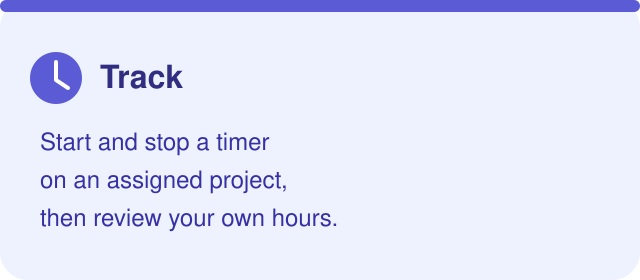
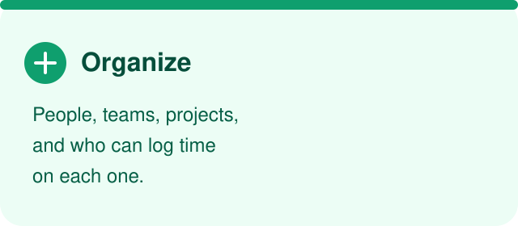

# Ora

Track hours on projects and activities, organize people and teams, and export reports. Built for small teams that want clear roles and a simple interface.

`Next.js 15` · `React 19` · `TypeScript` · `Tailwind CSS 4` · `Prisma + SQLite` · `MIT`

**Jump to:** [At a glance](#at-a-glance) · [Features](#features) · [Roles](#roles) · [Quick start](#quick-start) · [Windows installation](#windows-installer) · [Production hosting](#production-hosting-and-reverse-proxy) · [Releases](#releases-and-update-notices) · [Configuration](#configuration) · [Reports](#reports) · [Languages](#languages) · [Data](#data-to-remember) · [Roadmap](#roadmap)

---

## At a glance

|  |  |  |
|---|---|---|

---

## Features

| Area | What you get |
|---|---|
| **Timer** | Start and stop time on projects assigned to you, directly or through a team. |
| **Timesheet** | Review your own entries from **My Hours**. |
| **People and roles** | Create accounts, assign roles and teams, and control who can manage the workspace. |
| **First access** | New users set a password on first sign-in and use it afterwards. |
| **Reports** | Group by team, project, or user. Combine filters, pick columns, and export CSV or Excel. |
| **Themes** | Five light presets plus one dark theme. The light preset is remembered when you switch modes. |
| **Interface** | Fixed header, side navigation, account menu, themed fields, selects, checkboxes, and date pickers. |
| **Branding** | Name, tagline, description, light and dark logos, and available themes come from `.env`. |
| **Languages** | English, Italian, and Spanish, chosen from the browser and changeable in the header. |
| **Updates** | Owners and admins see a notice when a newer stable GitHub release is available. An administrator can run the separate Windows update runner; service control and restart remain manual. |

### Light themes


| Preset | When it appears |
|---|---|
| **Ora — default** | Always available. |
| **Ora blue** | Offered unless removed from `NEXT_PUBLIC_ORA_THEMES`. |
| **Ora green** | Offered unless removed from `NEXT_PUBLIC_ORA_THEMES`. |
| **Ora purple** | Offered unless removed from `NEXT_PUBLIC_ORA_THEMES`. |
| **Ora orange** | Offered unless removed from `NEXT_PUBLIC_ORA_THEMES`. |
| **Dark** | Single dark preset, independent of the light choice. |

The palette control is shown only in light mode. The sun and moon control switches modes and restores the last light preset.

---

## Roles

| Role | How it is assigned | What they can do |
|---|---|---|
| **Owner** | Created at first launch from `OWNER_EMAIL` and `OWNER_PASSWORD`, or through the one-time `/setup` flow. Email and password are later changed from **My Account**. | One owner per installation. Full access, including promoting users to admin and managing every account. |
| **Admin** | Assigned by the owner on the **People** page. | Manages people, teams, projects, and reports. |
| **User** | Created by an owner or admin with name, email, role, and team. | Logs and views their own hours on projects assigned directly or through a team. |

> Standard users never receive other people's entries from the API. Hiding a menu item is not the security control: the server enforces the role.

---

## Quick start

### Windows installer

Download or clone the project, then run **`install.cmd` as Administrator** in the project folder; administrator privileges are required to register the Windows service.

| Step | What the installer does |
|---|---|
| Install location | Copies the project to `%APPDATA%\Ora` (the current user's roaming AppData folder). Run `install.cmd` as Administrator to register the machine-wide Windows service. |
| Node.js | Uses Node.js 20 or newer. If it is missing, installs the current LTS with `winget`. |
| Packages | Runs `npm install`. |
| Configuration | Creates `.env` from `.env.example` and replaces `AUTH_SECRET` with a random value. An existing `.env` in the install folder is never overwritten. |
| Database | Initializes the fixed SQLite database at `%APPDATA%\Ora\prisma\ORA.db` and applies versioned migrations. The path is not configurable by users. |
| Service | Creates the automatic `OraTimeTrackingService` Windows service. Run the installer as Administrator. |
| Uninstall | `uninstall.cmd` removes the service and app after exporting project/team/user inventories to Excel; choose whether to retain app data. |
| What it does not do | Does not configure IIS/a reverse proxy. See [Production hosting](#production-hosting-and-reverse-proxy). |

Owner email and password stay empty, so the first start uses the one-time `/setup` page. The installer creates and starts the `OraTimeTrackingService` Windows service automatically. Then open [http://localhost:33333](http://localhost:33333), followed by [http://localhost:33333/setup](http://localhost:33333/setup). Change the listening port by editing `PORT` in `%APPDATA%\Ora\.env` and restarting the service. The service runs Ora in production mode.

### Production hosting and reverse proxy

The installer builds the production app and registers/starts the `OraTimeTrackingService` Windows service. It does not configure IIS, open firewall ports, or set up HTTPS; those tasks belong to whoever administers the target server.

| Responsibility | What the server administrator must arrange |
|---|---|
| Build and database | The installer configures `.env`, builds production assets, and applies migrations to the fixed `prisma/ORA.db`. Rebuild after changing any `NEXT_PUBLIC_*` value. |
| Windows service | The installer creates and starts `OraTimeTrackingService`, configured for automatic startup and recovery. |
| Network binding | Ora listens on `127.0.0.1` at `PORT` (default `33333`). It is intentionally not directly exposed to the network. |
| Reverse proxy | Configure your chosen reverse proxy to forward requests to `http://127.0.0.1:<PORT>`. For IIS, administrators typically install **IIS URL Rewrite** and **Application Request Routing (ARR)**, enable proxying, then configure a site, HTTPS binding/certificate, and rewrite rule to the local Ora address. IIS setup is not included in the installer. |
| Public URL | Set `APP_ORIGIN` to the public HTTPS URL (for example, `https://ora.example.com`). The proxy should preserve the public host and HTTPS information when forwarding requests. |
| Files and identity | Run the process under a Windows account that can read the install files and write to the configured SQLite database and the app directory (the one-time setup code is written there). |
| Database | One app instance and persistent storage. The database is fixed at `%APPDATA%\Ora\prisma\ORA.db`; it is not configurable by users. A service running under another account must use the same installation directory. |

**Quick IIS checklist:** install IIS and its URL Rewrite/ARR modules; enable ARR proxying; create the IIS site and bind the hostname with an HTTPS certificate; add a reverse-proxy rewrite rule to `http://127.0.0.1:33333` (or your configured port); set `APP_ORIGIN` to the public HTTPS URL; start `OraTimeTrackingService` and verify the site through IIS. Consult Microsoft IIS documentation for the exact module installation and rule steps for your Windows Server version.

After the first-time `/setup`, keep the app behind HTTPS and do not expose its local listening port directly to untrusted networks.

### Manual setup

**Prerequisites:** Node.js 20 or newer, and npm.

```bash
npm install
# create .env from .env.example, then:
npm run dev
```

Open [http://localhost:33333](http://localhost:33333) by default (or the port configured in `.env`).

### Choose how the owner is created

| Path | What to set | What happens |
|---|---|---|
| **One-time setup** | Leave `OWNER_EMAIL` and `OWNER_PASSWORD` empty. | First startup creates a temporary owner with no password and writes `owner-setup-code.txt` in the app directory. Open `/setup`, enter that code plus an email and password. The file is deleted when setup completes. |
| **Configured owner** | Set **both** variables. | The owner is provisioned with those credentials. Example values such as `owner@ora.local` and `changeme` must be replaced before the app is exposed. |

Changing the owner variables after the account exists does **not** change the live credentials. Use **My Account** and confirm the current password. The same account keeps its data and role.

> `owner-setup-code.txt` is excluded from Git, but the file itself has no special permissions. Protect access to the server while it exists.

### Run it for real

SQLite is intended for **one app instance on one machine**, with the database file on persistent storage.

| Setting | Default or note |
|---|---|
| SQLite database | Fixed path: `prisma/ORA.db`. The database path is not configurable by users. The updater retains the previous database as `prisma/ORA_Backup.db`. |
| Database files | Local `*.db` files and journals stay out of Git. Do not commit dumps. |
| Schema | Versioned migrations create an empty schema. |

```bash
npx prisma migrate deploy
npm start
```

`npm run build` and `npm start` also apply pending migrations before building or serving.

### Commands

| Command | Purpose |
|---|---|
| `npm run dev` | Development server (Turbopack). |
| `npm run lint` | ESLint. |
| `npx tsc --noEmit` | TypeScript check. |
| `npm run check:i18n` | Dictionary key completeness. |
| `npm run build` | Apply migrations, then production build. |
| `npm start` | Apply migrations, then production server. |

---

## Using Ora

### Sign in

1. Open the app and enter your email.
2. On first access, set and confirm a password.
3. After that, sign in with email and password.

### Navigation

The header stays visible while you move around. The menu button opens a side panel with the sections available to your role.

| Section | Who sees it |
|---|---|
| **Timer** | Everyone. |
| **My Hours** | Everyone. |
| **Reports** | Owner and admin. |
| **Projects** | Owner and admin. |
| **Teams** | Owner and admin. |
| **People** | Owner and admin. |

### Appearance and account

| Control | Behavior |
|---|---|
| Palette | Light mode only. Picks an Ora preset. |
| Sun / moon | Switches light and dark. Returning to light restores the selected preset. |
| Language | English, Italian, or Spanish. Saved in this browser as `ora-locale`. |
| Account menu | Shows name, email, and role. Sign out, or open **My Account**. |
| Theme memory | Saved in this browser (`ora-theme`, `ora-light-theme`). It survives sign-out and is not stored on the account. |

**Passwords and email**

- Any signed-in user can change their own password after entering the current one.
- Only the owner can change other people's email addresses.
- The owner can force a password reset: the stored hash is cleared and that person must choose a new password at the next sign-in.

### Day to day

| Area | What to do |
|---|---|
| **Timer** | Pick an available project or activity, then start and stop. |
| **My Hours** | Review your personal entries. |
| **People, Teams, Projects** | Configure the organization and assignments (owner and admin). |
| **Reports** | View and export workspace data (owner and admin). |

---

## Uninstalling Ora

Run `uninstall.cmd` as Administrator from the downloaded installer folder. The uninstaller stops and removes `OraTimeTrackingService`, exports complete project, team, and user inventories to three Excel workbooks in a timestamped folder under Documents, then asks whether to retain the application data. The user export contains names, emails, roles, team/project memberships, and creation dates; it never includes password hashes.

- **Keep data:** the app is removed, while `.env`, `ORA.db`, `ORA_Backup.db` (if present), and custom logos are copied beside the Excel exports.
- **Delete data:** the app and its configuration/database/logo data are deleted after Excel exports complete.

> The uninstaller does not remove Node.js or configure/alter IIS. If the database is missing, the Excel export fails, the service cannot be removed, or preserved database verification fails, it stops rather than deleting the installation.

## Releases and update notices

Ora checks GitHub Releases for the latest published **stable** version. Owners and admins see a notice in the app when a newer version is available, with a link to its release page. Standard users do not see the notice. The check is best-effort, runs in the background, and is cached in memory for up to 12 hours; if GitHub is unavailable, Ora continues normally without a notice. The notice is informational: it does not download an update automatically.

The Windows runner `scripts/update.ps1` downloads a published release and prepares dependencies, production assets, and a migrated copy of `prisma/ORA.db` while the current service stays online. When staging is ready, it stops `OraTimeTrackingService`, creates `prisma/ORA_Backup.db` and a versioned application/database backup, switches to the migrated database and new app files, then starts the service again. IIS remains administrator-managed. Verify the service and site after each update, and retain backups according to your recovery policy. The database location is fixed and is not user-configurable.

To publish a version, set the semantic version in `package.json` (for example, `1.2.0`), commit and push the change, create a Git tag such as `v1.2.0`, and publish a stable GitHub Release for that tag. The GitHub Actions workflow attaches `ora-v1.2.0.zip`; the external runner requires that asset and verifies the GitHub-provided SHA-256 digest. Drafts and prereleases are not used for update notices.

Run the updater from an elevated PowerShell window, replacing the path with the installation directory. It controls the service automatically:

```powershell
.\scripts\update.ps1 -InstallPath "$env:APPDATA\Ora"
```

The updater requires administrator privileges and the installed `OraTimeTrackingService`. Keep an independent verified backup of `ORA.db` and `.env` before use. It restarts the service after a successful update or a handled failure; it does not configure IIS. Verify the site and retain `ORA_Backup.db` and the versioned update backup until you are satisfied with recovery.

> The checker compares the installed package version with the latest stable release. Keep `package.json` aligned with the deployed version, and include clear backup and upgrade instructions in every release.

---

## Configuration

Copy `.env.example` to `.env`. Public values use the `NEXT_PUBLIC_` prefix and are **embedded in the bundle**. Set them before you start or build, and rebuild after every change.

### Branding

| Variable | Use |
|---|---|
| `NEXT_PUBLIC_APP_NAME` | Application name. |
| `NEXT_PUBLIC_APP_TAGLINE` | Short tagline. |
| `NEXT_PUBLIC_APP_DESCRIPTION` | Description and metadata. |
| `NEXT_PUBLIC_APP_LOGO_LIGHT` | Light-mode logo, only as `/custom/...`. |
| `NEXT_PUBLIC_APP_LOGO_DARK` | Dark-mode logo, only as `/custom/...`. |
| `APP_ORIGIN` | Public base URL of this installation. Defaults to `http://localhost:<PORT>`. Set it to the public HTTPS URL when hosted behind a reverse proxy (for example, `https://ora.example.com`). |
| `PORT` | Local HTTP listen port for the app. Defaults to `33333`; reverse proxies can forward to `http://127.0.0.1:<PORT>`. |

Logos must live in `public/custom/`. External URLs and any other path are rejected. If only one logo is set, it is used in both modes. With neither, Ora shows the text brand. `public/custom/` is not in Git: add the files on each installation.

### Themes and colors

| Variable | Use |
|---|---|
| `NEXT_PUBLIC_DEFAULT_THEME` | Initial light theme. Default `ora-default`; it must be one of the themes you expose. |
| `NEXT_PUBLIC_ORA_THEMES` | Extra light themes, comma-separated: `ora-blue`, `ora-green`, `ora-purple`, `ora-orange`. Do not list `ora-default`: it is always shown. Empty or missing means all themes. |
| `NEXT_PUBLIC_THEME_<NAME>_LABEL` | Label for `DEFAULT`, `BLUE`, `GREEN`, `PURPLE`, or `ORANGE`. |
| `NEXT_PUBLIC_THEME_<NAME>_COLOR` | Swatch color for that preset. |
| `NEXT_PUBLIC_PROJECT_COLORS` | Palette offered for projects. |
| `NEXT_PUBLIC_TEAM_COLORS` | Palette offered for teams. |
| `NEXT_PUBLIC_DEFAULT_PROJECT_COLOR` | Color for a new project. |
| `NEXT_PUBLIC_DEFAULT_TEAM_COLOR` | Color for a new team. |

### Session, secrets, and owner

| Variable | Use |
|---|---|
| `AUTH_SECRET` | Signing secret. In production use a random value. Placeholders are rejected at startup. |
| `SESSION_COOKIE_NAME` | Session cookie name. |
| `SESSION_DURATION_DAYS` | Integer from 1 to 365. Invalid numbers fail explicitly. |
| `PASSWORD_HASH_ROUNDS` | Integer from 10 to 15. Invalid numbers fail explicitly. |
| `OWNER_EMAIL` and `OWNER_PASSWORD` | Both set, or both empty. Production rejects a placeholder secret and a half-configured owner. |
| Database path | Not configurable. Ora always stores SQLite in `prisma/ORA.db` under the installation folder. |
| `PORT` | Local HTTP listen port (default `33333`); use this as the reverse-proxy target port. |

---

## Reports

Owners and admins open **Reports**, choose a grouping, combine filters, pick columns, and download the same selection.

### Grouping and filters

| Choice | Rule |
|---|---|
| **Focus** | Group by **project** (default), **team**, or **user**. |
| **Different filters** | Combined with **AND** (date and team and project and people). |
| **Values inside one filter** | Combined with **OR**. |
| **Duplicates** | An entry that matches several criteria is exported once. |
| **Dates** | Filtered by start time. The end date includes the whole day. |
| **Order** | Rows are sorted by start time, ascending. |

### Columns

Date, person, email, team, project, activity, start, end, duration, and note. Unselected columns are omitted. Internal column keys stay stable; the labels follow the selected language.

### File format

| Format | One group | Several groups |
|---|---|---|
| **CSV** | A single `.csv` file. | A `.zip` with one CSV per item. |
| **Excel** | One workbook, one worksheet. | One worksheet per item. Duplicate names are made unique; long names are shortened to Excel's 31-character limit. |

Headers, dates, numbers, fallback text, file names, and worksheet titles follow the application language (English, Italian, or Spanish).

---

## Languages

| | |
|---|---|
| **Available** | English, Italian, Spanish. |
| **First visit** | The first supported language in the browser preferences. Anything else falls back to English. |
| **Remembered as** | `ora-locale` in this browser. |
| **Change it** | Language selector in the header. |
| **Also translated** | Setup, sign-in, the signed-in app, and CSV and Excel report content. |

Adding a language means adding a typed dictionary in `src/i18n/messages.ts` and running `npm run check:i18n`. Editing translations inside the app is a possible later step, not part of the current setup.

---

## Data to remember

| Topic | Behavior |
|---|---|
| Where data lives | Users, teams, projects, and time entries are stored in the configured SQLite file, not only in the browser. |
| Deleting a user | Also deletes that person's time entries. |
| Deleting a project | Also deletes the time entries on that project. |
| Deleting a time entry | Removes it from active data and from reports. |
| Deleting a team | Leaves existing projects in place, without that team. |
| Recovery | There is no trash or history archive. Deletion is not reversible from the app. |
| Backups | Not automatic. Copy the SQLite file with your own server procedure before important deletions. |

---

## Roadmap

| When | Item |
|---|---|
| Next | Validate exports against large datasets and edge cases. |
| Next | Automated regression tests for exports, authorization, and theme persistence. |
| Later | Extra sorting and formatting options for reports. |
| Later | Desktop app with Tauri. |
| Later | Jira integration: link projects and issues, then synchronize worklogs. |
| Later | Request-locale convention for API errors outside report export (those responses are still Italian). |
| Later | In-app translation editing. |

---

## Stack

| Layer | Choice |
|---|---|
| App and API | Next.js 15 App Router, React 19 |
| Language | TypeScript |
| UI | Tailwind CSS 4, CSS variables for themes |
| Data | Prisma and SQLite |
| Auth | bcryptjs passwords, signed session cookies |
| Spreadsheets | ExcelJS; CSV archives use fflate |

Development conventions live in [AGENTS.md](./AGENTS.md). License: [MIT](./LICENSE).
